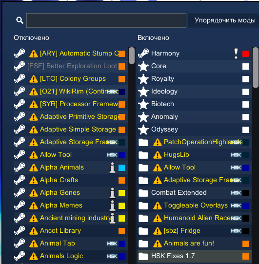

# HSK Fixes 1.7

## ⚠️ Важно

> [!WARNING]
> **Не пишите о багах с версии 1.7 в тему багов до официального релиза — за это можно получить бан.**
>
> 1.7 — нестабильная ветка, и Hardcore SK под неё пока не портирован. Всё, что здесь исправляется, —
> временные заплатки снаружи, а не готовая поддержка версии. Поломки, которые вы увидите на 1.7, в
> большинстве своём известны и к релизной версии пака отношения не имеют, поэтому такие сообщения
> только мешают разбирать настоящие баги.

Правки, которые нужны Hardcore SK и модам его состава **именно на RimWorld 1.7**. Код самого пака
не меняется — всё делается снаружи.

Без этого мода на 1.7 пак остаётся без своих настроек и без своих патчей, несколько модов теряют
часть своей функциональности, а дерево исследований стирается при прокрутке.

## Требования

**RimWorld 1.7.** Мод рассчитан только на неё; на 1.6 он просто не загрузится.

**Harmony — из Steam Workshop.** Это важно: 1.7 больше не использует Unity и несёт собственную
сборку рантайма .NET (`10.0.10-waylithclr.dev`). Старые версии Harmony на нём отказываются
работать — MonoMod внутри них сверяет версию CoreCLR со списком известных и на незнакомой бросает

```
PlatformNotSupportedException: CoreCLR version 10.0.10 is not supported
```

Это не одна ошибка, а около двухсот мёртвых классов: исключение уносит статические конструкторы
модов целиком. Версия из мастерской (на октябрь 2026 — Harmony 2.4.1) работает.

В списке модов у Harmony будет значок предупреждения: в её `About.xml` версии заявлены по 1.6
включительно. Это ожидаемо, мод загружается и работает.

## Установка

1. Положить папку мода в `RimWorld/Mods/` (или сделать на неё junction).
2. Включить мод в списке.
3. Выставить порядок загрузки — см. ниже.

## Порядок модов

Правило в одну строку: **после Combat Extended, до Hardcore SK.**

Мод объявляет это в `About.xml` (`loadAfter CETeam.CombatExtended`, `loadBefore skyarkhangel.HSK`),
но автосортировка не всегда ставит его верно, поэтому порядок стоит проверить глазами.



Тем же списком текстом:

```
 1. Harmony            <<< 1.7, из Steam Workshop
 2. Core
 3. Royalty
 4. Ideology
 5. Biotech
 6. Anomaly
 7. Odyssey
 8. PatchOperationHighlander
 9. HugsLib
10. Allow Tool
11. Adaptive Storage Framework
12. Combat Extended
13. Toggleable Overlays
14. Humanoid Alien Races
15. [sbz] Fridge
16. Animals are fun!
17. HSK Fixes 1.7      <<< этот мод
...
    Hardcore SK
    Hardcore SK - Core
    Hardcore SK - DLC
    ... остальные моды пака
```

Точный состав модов с 8-й по 16-ю у вас может отличаться — значение имеет только относительное
положение: Harmony и Core с дополнениями выше, Combat Extended выше, Hardcore SK ниже.

**Почему порядок важен.** Мод делает свою работу из конструктора `Mod`-класса, то есть в тот
момент, когда игра создаёт классы модов по порядку загрузки. Он успевает собрать `Mod`-класс Core SK
и зарегистрировать его **раньше**, чем игра дойдёт до пакового — поэтому упавший конструктор пака
просто не вызывается. Поставьте мод после пака, и этот приём работать не будет.
